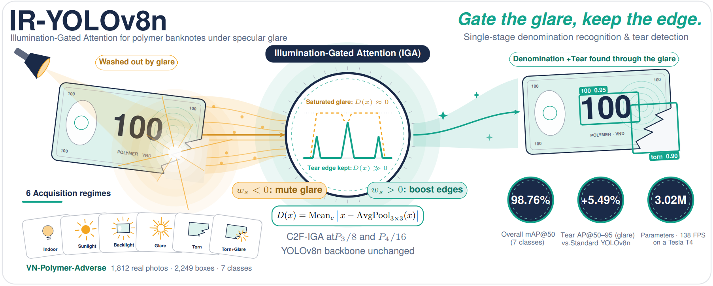
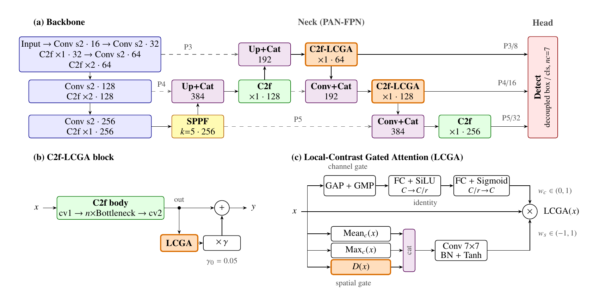

# Polymer Banknote Recognition and Tear Detection under Adverse Illumination: A Benchmark and Local-Contrast Gated Attention


Official PyTorch implementation of **IR-YOLOv8n** with **Local-Contrast Gated Attention** for robust banknote recognition and defect detection under challenging illumination (specular glare, overexposure, harsh backlighting).

<p align="center">
  
</p>

---

## Architecture Overview

<p align="center">
  
</p>

---

## Quick Start

### 1. Installation

Clone this repository and install dependencies:

```bash
git clone https://github.com/tmai110605/IR-YOLOv8n.git
cd IR-YOLOv8n
pip install -r requirements.txt
```

### 2. Dataset Preparation

Organize your dataset following the standard Ultralytics YOLO format:

```text
Cash/
├── data.yaml
├── train/
│   ├── images/
│   └── labels/
├── valid/
│   ├── images/
│   └── labels/
└── test/
    ├── images/
    └── labels/
```

Verify your `data.yaml`:

```yaml
path: .
train: train/images
val: valid/images
test: test/images

nc: 7
names: ['10', '100', '20', '200', '50', '500', 'torn']
```

---

## Training IR-YOLOv8n

To train the proposed IR-YOLOv8n model from official COCO-pretrained weights:

```bash
# Train on GPU 0 with default paper recipe (100 epochs, batch 16, imgsz 640)
python train.py --data data.yaml --device 0

# Custom parameters
python train.py --epochs 100 --batch 16 --imgsz 640 --device 0 --name ir_yolov8n

# Train on CPU
python train.py --device cpu
```

### Training Configuration
- **Optimizer**: AdamW (`lr0=0.00091`, `momentum=0.9`, `weight_decay=0.0005`)
- **Schedule**: Cosine Annealing (`cos_lr=True`)
- **Augmentation**: Mosaic enabled for epochs 1–90, disabled for the final 10 epochs (`close_mosaic=10`)
- **Weights Transfer**: Official COCO-pretrained `yolov8n.pt` (transferring 319 aligned backbone/neck tensors)

Outputs will be saved in `runs/detect/ir_yolov8n/`.

---

## Evaluation & Validation

To evaluate the provided optimal checkpoint on the test split:

```bash
python val.py --weights runs/detect/ir_yolov8n/weights/best.pt --data data.yaml --split test
```

---

## Pretrained Weights & Training Artifacts (runs/detect/ir_yolov8n/)

This repository includes the complete empirical training run directory of IR-YOLOv8n (`runs/detect/ir_yolov8n/`), allowing direct reproducibility and immediate inference without retraining:

- **`weights/best.pt`** (~6.2 MB): Optimal checkpoint achieving **98.77% mAP@50** and **93.21% mAP@50-95** on the adverse-illumination test set.
- **`weights/last.pt`** (~6.2 MB): Model checkpoint saved at epoch 100.
- **`args.yaml`**: Full hyperparameter specification and runtime arguments strictly recorded during training.
- **`results.csv` & `results.png`**: Epoch-by-epoch convergence metrics (box loss, cls loss, dfl loss, mAP@50, mAP@50-95).
- **`BoxPR_curve.png` & `BoxF1_curve.png`**: Precision-Recall and F1-Confidence curves across all 7 classes.
- **`confusion_matrix.png` & `confusion_matrix_normalized.png`**: Normalized confusion matrices across banknote denominations and tear defects.
- **`val_batch*_pred.jpg` & `train_batch*.jpg`**: Ground-truth vs. predicted detection visualizations on validation batches.

---

## Citation

If you find this work, pretrained models, or code useful for your research, please consider citing:

```bibtex
@article{mai2026polymer,
  title={Polymer Banknote Recognition and Tear Detection under Adverse Illumination: A Benchmark and Local-Contrast Gated Attention},
  author={Mai, Quoc Thai and Nguyen, Xuan Phi and Ho, Ngoc Tien and Nguyen, Huy Gia Toan},
  journal={Pattern Recognition Letters},
  year={2026},
  note={Submitted}
}
```
